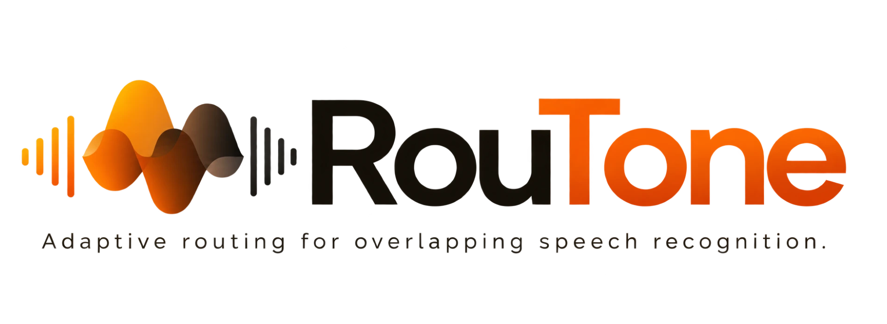

<p align="center">
  <picture>
    <source media="(prefers-color-scheme: dark)" srcset="apps/web/public/brand/routone-logo-dark.png">
    <source media="(prefers-color-scheme: light)" srcset="apps/web/public/brand/routone-logo-light.png">
    
  </picture>
</p>

<h3 align="center">Understand mixed speech. Route only when necessary.</h3>

<p align="center">
  A speech research workbench that transcribes overlapping conversations and decides, region by region,<br>
  whether speech separation is worth its computational cost.
</p>

<p align="center">
  <a href="https://github.com/Sudharsanselvaraj/RouTone-ASR/actions"></a>
  
  
  
</p>

---

## How it works

1. **Transcribe the mixture** with faster-whisper.
2. **Detect candidate overlap regions** with an acoustic heuristic.
3. **Route each region**: transcribe directly, or separate first with ConvTasNet, based on predicted benefit versus latency cost.
4. **Reconcile** the mixture and separated-stream transcripts into one speaker-attributed result.

Every value in the UI is labelled as *measured*, *estimate*, *heuristic* or *fixed default*, and benchmark results carry a validity status.

## Workspaces

| | |
|---|---|
| **Overview** | Audio workspace, research workflow, saved runs, run comparison |
| **ASR Studio** | Demo / upload / microphone, real waveform, transcript viewer, TXT · SRT · VTT · JSON export |
| **Overlap Inspector** | Multi-lane timeline, region evidence, mixture-vs-stream comparison, reconciliation audit |
| **Adaptive Routing Lab** | Policy comparison on a recording, decision inspector, benefit-vs-cost chart, real pipeline trace |
| **Benchmarks** | Strategy comparison, accuracy-vs-latency plot, integrity warnings, history |

## Quick start

```bash
make setup     # Python venv + npm install
make server    # API on http://127.0.0.1:8000
make web       # UI  on http://localhost:5173
```

```bash
make test                       # backend tests
cd apps/web && npm test         # frontend unit tests
make eval                       # run the benchmark suite
```

Requires Python 3.11+ and Node 20+. The default benchmark dataset uses macOS text-to-speech (`say`); elsewhere it falls back to a tone dataset that the report marks **invalid**.

## Stack

faster-whisper · ConvTasNet (torchaudio) · PyTorch · FastAPI · React 19 · Vite · TypeScript

## Limits worth knowing

- Overlap detection and the benefit predictor are **uncalibrated heuristics**; the speaker count is a fixed default of 2.
- Both models run on **CPU**.
- The bundled benchmark has **3 samples**, so no strategy difference is statistically meaningful. Details in [`docs/BENCHMARK_AUDIT.md`](docs/BENCHMARK_AUDIT.md) and [`docs/LIMITATIONS.md`](docs/LIMITATIONS.md).

## Docs

[Architecture](docs/ARCHITECTURE.md) · [Methodology](docs/METHODOLOGY.md) · [Experiments](docs/EXPERIMENTS.md) · [Benchmark audit](docs/BENCHMARK_AUDIT.md) · [Spec](SPEC.md)

## License

Apache 2.0. See [LICENSE](LICENSE) and [model and data licenses](docs/DATA_AND_MODEL_LICENSES.md).
